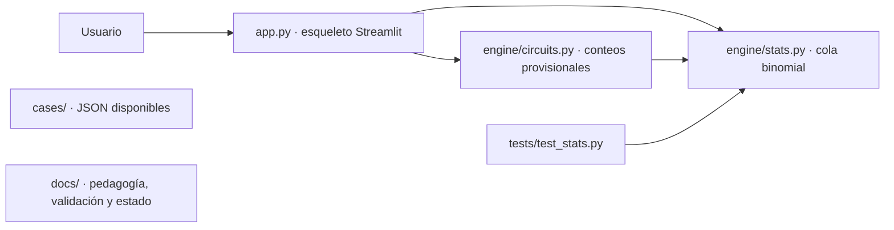

# Arquitectura observada y puntos de integración

Base inspeccionada: `b1a126c`, 24 de octubre de 2026. Los contenidos de esta rama amplían los JSON y la documentación, sin cambiar firmas ni implementar el motor o la interfaz.

## Flujo que existe



`cases/` aparece sin conexión a la app porque todavía no se carga desde `app.py`. La flecha de `circuits.py` a `stats.py` corresponde a `rx_counts`; la interfaz actual solo llama a `coin_counts`.

| Componente | Responsabilidad observada | Detalle |
|---|---|---|
| `app.py` | Presentación de una prueba | Llama `coin_counts(10, seed=1)` y muestra por separado `p_value_at_least(7, 10)`; no calcula el p-valor a partir del conteo mostrado |
| `engine/circuits.py` | Interfaz provisional de conteos | `coin_counts(shots, seed)` y `rx_counts(theta_deg, shots, seed)` devuelven `{"0": n0, "1": n1}` mediante aritmética determinista |
| `CODE_COIN`, `CODE_RX` | Fragmentos de texto | Contienen operaciones H/RX y medición; no los ejecutan las funciones ni los muestra la app actual |
| `engine/stats.py` | Cálculos clásicos | Cola binomial `p_value_at_least`, probabilidad `prob_one` y error cuadrático `loss` |
| `cases/caso1.json` | Expediente oficial versión 2 | Sami añade H a las 21:14; Rumi retira el módulo a las 21:19; auditoría, reconstrucción y final PHI/Φ; todavía no consumido por la app |
| `cases/glossary.json` | Definiciones educativas | Objeto plano de término a texto |
| `cases/quiz.json` | Instrumento de contenido | Listas `pre` y `post`, cada una con tres ítems |
| `tests/test_stats.py` | Verificación matemática limitada | Comprueba `176/1024` y la probabilidad 0,75 para RX(120°) |

Con los parámetros actuales, la app recibe 5 ceros y 5 unos, mientras el p-valor mostrado corresponde a 7 unos de 10. Es una pantalla de integración provisional; no un análisis coherente de esa misma muestra. A debe vincular ambas cifras al resultado real cuando integre la actividad.

## Contratos de contenido preservados

```json
{"termino": "definicion"}
```

```json
{"pre": [{"q": "...", "options": ["...", "...", "..."], "answer": 0}], "post": [{"q": "...", "options": ["...", "...", "..."], "answer": 0}]}
```

El segundo bloque ilustra la forma; el archivo real contiene tres preguntas por fase. `answer` es un entero desde cero y debe estar dentro del arreglo de opciones. No se agregan metadatos a los ítems; el mapa de objetivos se mantiene en los documentos pedagógicos y de validación.

El expediente versión 2 conserva `title`, `incident`, `suspects`, `solution` y `hook`, y añade `schema_version`, `setting`, `detective`, `timeline` y `evidence`. La solución exige `audit_memory` y `circuit_reconstruction`, con `culprit = sami`. Los circuitos son H y H–H sobre 0, medidos al final; se elimina el ángulo RX del caso. Algunos accesos son `null` por falta de datos. El esquema completo y las reglas se describen en [MIGRACION-NARRATIVA.md](MIGRACION-NARRATIVA.md).

[CONTRATO.md](../CONTRATO.md) sigue describiendo interfaces y evidencias anteriores: no se modificó desde Persona 3. Conservar las claves generales no hace compatible la nueva semántica; A y B deben adaptar los consumidores y acordar la actualización de su contrato. No aplicar la regla de declaración falsa a este expediente.

## Integración acordada en el contrato, aún pendiente

`engine/game.py` debería cargar los JSON y ofrecer `evidence_table`, `coin_evidence`, `experiment_attempt`, `gradient_hint`, `statement_is_true` y `accuse`, además de los cargadores. Esas funciones están descritas, pero el archivo no existe en esta base. Tampoco existe `engine/demo.py`; por ello `python -m engine.demo` no es un comando de reproducción disponible.

El responsable B debe implementar H/H–H reales y la resolución por auditoría más reconstrucción, tolerando accesos desconocidos. A debe conectar la UI a esos resultados y mostrar cronología y final PHI/Φ. C entrega el caso migrado por decisión explícita del equipo. La nota técnica precisa en MIGRACION-NARRATIVA.md identifica los cambios sin alterar las firmas públicas desde esta rama. Datos aprobados e integración funcional son estados distintos.

## Decisiones y reproducibilidad

Separar presentación, cálculos y contenidos permite corregir lenguaje o preguntas sin editar algoritmos. Los diccionarios simples facilitan el intercambio y los JSON no requieren dependencias adicionales. La separación está presente en archivos; la integración de contenido sigue pendiente.

La fórmula clásica es una referencia exacta útil para contrastar el futuro muestreo Qiskit. El motor actual ignora las semillas; repetir resultados hoy no demuestra reproducibilidad de un simulador. Una vez integrado, se deben registrar versiones, semillas, shots y modo de ejecución, y comprobar que el código mostrado coincide con el ejecutado.

No hay servicio remoto, base de datos ni trabajo IBM Quantum en el código inspeccionado. El enlace Vercel suministrado no se puede asociar a esta arquitectura con la evidencia disponible; véase [INSPECCION-CONTENIDO.md](INSPECCION-CONTENIDO.md).
